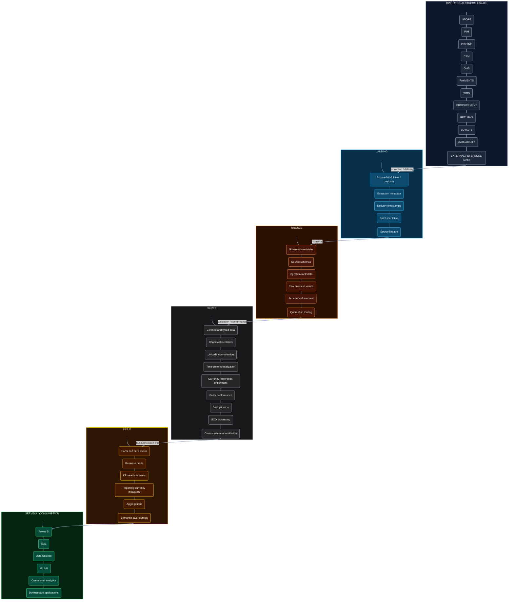

## Mercatura Data Platform - Architecture Overview (22nd November 2026)

### Purpose

This project intends to create the Mercatura data platform, providing a governed analytical platform for integrating data from a multinational operational data estate.

This operational data estate spans across multiple operational systems each of which have different: ownership boundaries, grains, temporal semantics, update patterns, currencies, languages, timezones, data quality characteristics, and operational responsibilities.

Therefore the focus of development currently, given the completion of the operational system simulation, is the transformation of hetrogeneous operational data into trustworthly, governedm and reusable enterprise downstream data products.

The current proposed lifecycle is:

1) Operational system simulation emits source data
2) The source data is extracted
3) This data is then landed into the platform
4) Bronze ingestion
5) validation / quarantine
6) Trusted silver tables
7) Establishment of gold layer
8) Serving / consumption / additional semantic layer

Throughout the lifecycle, governance, security, lineage, metadata, data quality, observability, testing, CI/CD, recovery, and cost management will be core factors being taken into account.

### Architectural Objectives

The core architectural objectives of the platform include:

#### Operational Truth Preservation

The original representation of the operational data will remain recoverable and faithfully preserved. This way important fields detailing: local currencies, native language text, original timestamps, source identifies, source system status values, source precision, and source business semantics are maintained and not overwritten.

The standardization of data fields used for enterprise representations will be derived downstream to avoid mutating the source truth.

#### Ingestion and Business Transformation

Ingestion in bronze will keep the original source information faithful to was is observed into raw operational system outputs.

Silver and gold layers will progressively enrich data and perform validation, providing business semantics and standardization.

Separating these two approaches is intended to improve traceability, debugging, replayability, auditability, and effective reconciliation.

#### Reproducible Processing

For reproducible processing, I want the same source inputs and transformations to provides the same result post-processing.

Therefore, the core pipeline logic will include idempotent writing, deterministic data transformations, consistently stable business keys, explicit effective dates, and controlled pipeline replays.

#### Support of Multiple Ingestion Pattenrs

Since I am deailing with a multitude of operational systems, all of which can evolve. There would be a multitide of combinations regarding the extraction methods of the source systems.

For instance, data estates can include: schedules batch extracts, database snapshots, change data capture, REST APIs, event streams, object storage deliveries, and external reference feeds.

Threrefore the downstream processing contract will be standardized and consider upstream systems that operate differently from each other.

#### Governance as Architecture

Governance will be central to this project and will be considered throughout development rather than just at the end. Access controls. lineage, ownership, schema management, data classification, and auditability will be incorporated consistently into the platform design from ingestion onwards.

---

### Logical Architecture



---

### Source System Boundaries

The operational systems remain authoritative for the operational events. For example, the OMS owns orders, Payment system owns the payment attempts and refunds, WMS owns the physical inventory movements, and so on...

When this data is in the data platform, the ownership is not redefined. Instead, the approach will be ti integrate the outputs of the operational systems. 

This explicit distincution in data ownership is significant, since data inconsistencies are to be tracable all the way back to the corresponding source system rather than resolved via arbitrary warehouse assumptions regarding source data ownership.

---

### Extraction Layer

Extraction refers to the mechanism by which data leaves an operational system. Currently the source estate generator produces deterministic JSONL extracts. These JSONL files represents a controlled simulator format, but I am not making a concrete architectural assumption that every source system extracts with JSONL or even a file format. I will be considering source extractions using REST API, schedules storage exports, event streams, and so on... as this is more realistic as source systems tend to have different extraction formats.

---

### Extraction Metadata

Since this project is intended to lean towards more advanced production grade engineering. I am considering that a production grade extraction will carry a rich payload of metadata detailing: the data origin, extraction date/time, extraction run identification, source interval representation, extract completion status, extract reprocessing status (has the extract been processed before?), and replayability.

The exact metadata contract detailing the desired metadata columns will be defined during the source contract construction phase of the project.

---

### Landing Layer

The landing layer will be the first location controlled by the proposed data platform. The landing layer receives the source system data deliveries before thay are transformed into Databricks analytical tables.

Ultimately, the responsibilities of this layer include data capturing, preservation, enabling extensive traceability and replayability logic.

Landing will be considered immutable, or append oriented where practical. The immutability condition should avoid breaking data preservation.

If in the circumstance that corrected data arrives, the corrected payload shall itself be represented as another identifiable source data delivery.

---

### Bronze Layer

The Bronze layer will provide the governed raw representation of source data. It will preserve all the source data semantics faithfully while simultaneously enriching the data with metadata fields.

The broader Bronze layer reponsibilities include: schema application, type parsing only where it is contractually safe, ingestion metadata enrichment, source lineage, duplicate delivery protections, quarantine of malformed records, Delta persistence, and technical validation. All more detailed standardization transformations will be performed downstream to keep the bronze source data representation preserved.

For example, a CNY transaction will remain a CNY transaction. A Japanese product will remain Japanese, and a local timetamp will not be allowed to lose its source timezone meaning.

---

### Bronze Metadata

The metadata enrichment in Bronze will likely include adding metadata columns such as the following: 

- _ingested_at
- _source_system
- _source_entity
- _extract_id
- _batch_id
- _source_file
- _source_row_number
- _schema_version
- _record_hash

These metadata fields are sufficient to enable effective data lineage, reconciliation capabilities, easier pipeline debugging, sufficient deduplication, replayability, and auditing.

---

### Quarantine

Invalid data will not be discarded, instead it will be handled with a quarantine policy. First, the distrinction between accepted and quarantined records will be established and the relevant characteristic qualifications a record must have to be either retained and propagated throghout the pipeline further, or quarantined.

The quarantine will provide an auditable destination for records that fail defined contracts.

Quarantine will have reasoning attached, with reasons included (but not limited to): invalid schema, missing mandatory fields, invalid identifies, impossible enum values, invalid temporal relationships, malformed decimal, unsupported currency, or unparseable timestamps. Quaranties could be further partitioned into soft and hard failures for more permissable routing and persistence of soft into downsteam products, however this would have to be carefully reviewed.

A quarantied record will retain the original payload, the failure reason, data quality rule identifier, source metadata, and the ingestion run. This enrichment of the quarantine record will enable pipeline failure / data quality investigations and recovery efforts to be more operationally smooth.

---

### Silver Layer

The silver layer represents conformed enterprise data, and includes standardizations, normalizations and transformations of data. The responsibilities of the silver layer include: deduplication, type standardization, unicode normalization, timezone conversions, reference data enrichment, cross-system conformance, business rule validation, late arriving record handling, SCD processing, currency enrichment, and unit normalization to name some of the silver characteristic features.

The silver layer data will remain detailed enough for thorough reconciliation, but will not prematurely perform any major data aggregations as this is reserved for the Gold layer.

---

### Canonical Identifiers

The silver layer will progressively establish more stable enterprise identifiers. Operational systems could use different identifiers for equivalent entities, causing confusion regarding whether different entities refer to the same business concepts.

Therefore, the conformance of the data will be explicit, and entity meaning resolutions will ultimately distinguish betweeen source identifier, canonical enterprise identifiers, matching evidence, and entity matching confidence where it is required.

I am really avoiding overwriting one equivalent identifier with another.

---

### Multilingual Data

The international source estate contains unicode text, which is being preserved in their native representations. This representation will be retained in the landing and bronze layers with the original source values.

In silver, I will derive normalized or transliterated forms. Then, in gold further transformation can be done to expose business facing English labels where reporting dashboards and analytics requires them.

Overall, the proposed flow is:

1) Starting with the original source text
2) The original source representation is preserved in landing and Bronze layers
3) Optional transliteration and translation in silver / gold layers

The key thing I am ensuring is that the translated values do not become the canonical identity of source data.

---

### Unicode Normalization

Visually identical unicode strings may have different binary representations. Therefore in the silver transformations I may need to normalize comparison fields using a documented unicode normalization form, which will likely be NFC.

For example:

```py
unicodedata.normalize(
    "NFC",
    value,
)
```

The source representation should still be rexoverable. The purpose of the normalization is to improve matching logic, deduplication of fields, comparisons, effective record searching, and hash stability, rather then eliminating the multilingual source values.

---

### Currency Architecture

The operational monetary values will be preserving both the amount and the currency code since these two attributes form the minimum basic monetary representation.

I will also ensure that no global financial aggregation should occur until values have been converted to a declared reporting currency (likely to be GBP).


---

### Foreign Exchange Reference Data

Foreign exchange will enter the data platform as reference data rather than originating from the operational source estate simulator.

The future FX dataset could contain fields detailing mappings of currency values, exchange rates, timestamp of the current valid exchange rate, provider, etc...

---

### Temporal Architecture

The underlying time architecture is more complex than a singular timestamp. The temporal concepts being considered includes: business event time, local event time, UTC event time, effective time, processing time, extraction time, landing time, ingestion time, and so on ... each of which communicate different temporal information that each have differnet uses.

---

### Timezones

The platform operates across a multitude of IANA timezones. IANA zone identifies are preferred over static UTC offests because offsets may change with daylight saving rules.

Therefore, where source systems expose a local timestamp, the source time zone will be known allowing for a reliable UTC conversion to occur.

---

### Late-Arriving Date

I will not be assuming that events always arriving in strict chronological order. Thererfore the platform will support late events, late dimensions, replayed batches, backfilling, and corrected data deliveries without corrupting historical data.

---

### Idempotency

The pipeline will be idempotent by design, therefore when processing the same input, the pipeline operations does not create duplicate business effects. 

The idempotency implementation will be contral around design and transformation efforts. The mechanisms for ensuring idempotency include: extrad ID, batch ID, business keys, record hashes, merge operations, watermarks, and deduplication windows. 

---

### Replay and Recovery

The landing data will support controlled replay capabilities. So, if a transformation contains a defect, the platform will be capable of having code corrected, identigying impacted source intervals, reprocessing preserved source inputs, and reconciliation of the resulting output, rather then requiring the upstream operational system to regenerate historical data agin.

---

### Schema Evolution

Realistically, operational schemas are not static, they tend to change, and I intend to handle schema evolution in this project.

Therefore, the platform will distinguish between the nature of the schema evolution, whether it is a: compatible change, a breaking change, and unexpected change, or the invalidation of source data.

Examples of potential schema evolution mechanisms include: now optional columns at source, new enum values, the removal of a column, a change in data type, renaming of columns, or changes in column nullability.

The schema evolution will be governed via explicit contracts rather than through schema inference.

---

### Privacy Policy and PII

The CRM and loyalty source data domains contain personally identifiable information. Therefore, for appropriate data governance, the platform will be able to classify and protect PII fields.

The governence controls considered include: unity catalog privileges, column masking, row filtering, restricted schemas, service principal access, audit logging, and retention controls. 

The exact specifics of the governence policies will be documented when these factors become more at the forefront of immediate focus.

---

### Gold Layer

The gold layer of the platforms data lakehouse will contain trusted data products that are business oriented. Therefore, transformations in gold will surround creating explicit analytical intent with the data products.

Examples of what could be established in the gold layer include:

- Sales fact table
- Refunds fact table
- Inventory snapshot fact table
- Fulfilment fact table
- Customer dimension
- Product dimension
- Store dimension
- Market dimension
- Supplier dimension
- Date dimension
- Sales performance mart
- Customer retention mart
- Inventory risk mart
- Supplier performance mart

All the outputs from the gold layer will have substantially documented grain, business keys, metric definitions, ownership declarations, and quality expectations, alongside another layer of data quality rules that test aggregated business metric validity.

---

### Semantic Layer

The semantic layer will sit on to ob the gold layer and will be most relevant for serving dashboards. The dashboard measures will not rely on analysts independently reimplementing business logic and recaculating measures. 

The semantic layer will formally contralize definitions such as: net revenue, gross revenue, return rate, customer retention, availability, days of cover, and supplier OTIF. The semantic layer serves to reduce metric definition divergence and act as a central unified repository for business related metrics. The calculation policy of these metrics will be transparent and testable, and shared across different departmental use cases.

---

### Serving

Potential downstream data consumers include:

- Power BI
- Databricks SQL
- Data analysts
- Data scientists
- ML pipelines
- AI applications
- Operational reporting
- Downstream services

The serving architecture will be dependent on the workload as not every consumer requies the same latency, gain, data freshness, cost allocation, or query interface.

---

### Observability

Pipeline observability will be a core focus as a successful processing pipeline job does not be definition means that the data is correct. Therefore I will incude a number of observability mechanisms eventually, including:

- Job status
- Record counts
- Quarantine counts
- Data freshness
- Processing duration
- Data volume
- Schema changes
- Reconciliation results
- Quality rule failures
- Watermakrs
- Cost

Operational dashboards and automated alerts will be used to prioritize actionable recovery signals.

---

### Pipeline Failure Model

I will also be considering the modes of pipelien failure that can occur for this project. Ideally, the platform will distinguish failure types into classes such as:

- Source unavailable
- Extract incomplete 
- Landing failure
- Schema violation
- Data quality failure
- Transformation failure
- Reconciliation failure
- Sering failure

Different classifications of failure will require different recovery actions, and therefore the alert publishing material will have to account for specific recovery modes for failure types.

---

### Orchestration

The pipeline orchestration will consider explicit dependencies and will operate sequentially.

Dependencies are expected to arise from data requirements as opposed to arbitrary scheduling delays.

---

### Batch and Streaming

Although I would eventually add streaming capabilities to the project, I am currently focusing on batch processing first. Streaming will be appropriate where the requirement is low latency.

Batch is comparatively simpler to implement and still have only moderate latency depending on the implementation quality.

Eventually, the data platform architecture will support both batch and streaming patterns without having to force every single workload into a singular model.

---

### Delta Lake

All the managed analytical tables will use Delta Lake. Delta Lake tables provides useful characteristics such as: ACID transactions, schema enforcement, MERGE, time travel, versioned table history, and optimized file management. These characteristics support the data platform requirements for reliable ingestion, replays, incremental processing, and auditability.

---

### Performance Optimization

Performance optimization will be a large focus in this project and will follow evidence driven investigations and subsequent improvements to the pipeline processing implementation.

Potential techniques that may be applied during the optimization phase include:

- Appropriate partitioning
- Liquid clustering
- Data skipping
- File compaction
- Predicate pushdown
- Broadcast joins
- Incremental processing
- Materialized aggregations

These will be applied after thorough investigation and understanding of relevant table sizes, query patterns, cardinality, write behaviour, and maintainence cost trade offs,

---

### Cost Management

Operations and architectural decisions on the data platform impact the resulting cloud expenditure figures. Therefore throughout the project I will monitor things such as:

- Compute duration
- Warehouse usage
- Job frequency
- Data volumes
- Storage growth
- Inefficiency in scans
- Unnecessary recomputations

Since production quality solutions heavily consider cost efficiency, I naturally will also put extra emphasis on this.

---

### Recovery Philosophy

Pipeline failures naturally occur, and I intend to create scenarios where failures occur and are recovered and documented with resolutions. Designing around recovery will be a key factor during development.

A recoverable pipeline will make it possible to determine:

- What failed
- When it failed
- Which data was impacted
- What was already committed
- Whether reruns are safe
- Which source interval may need to be replayed
- Whether downstream outputs require rebuilding.

Naturally the idempotency and lineage design considerations are foundational to making recoverability viable.

---

