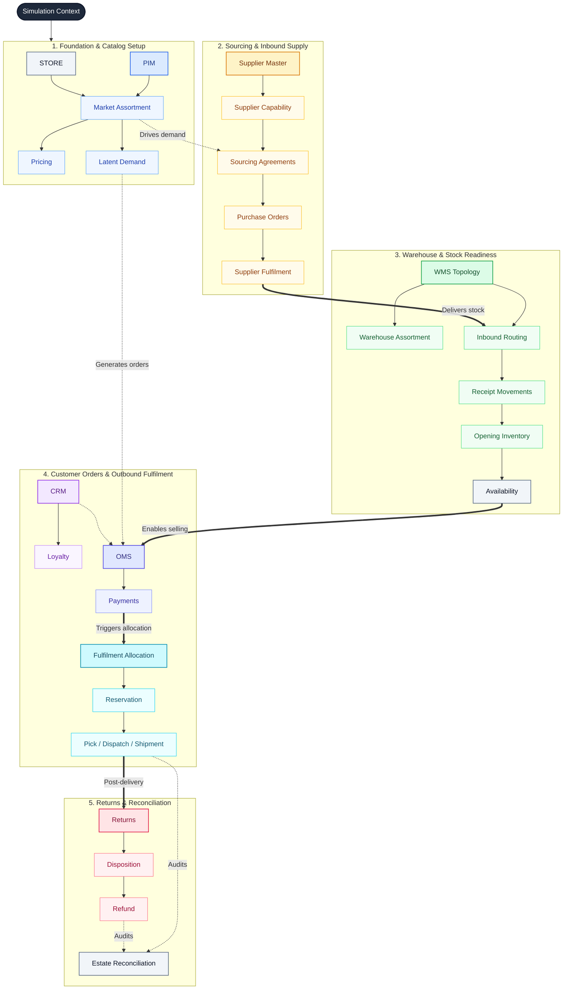
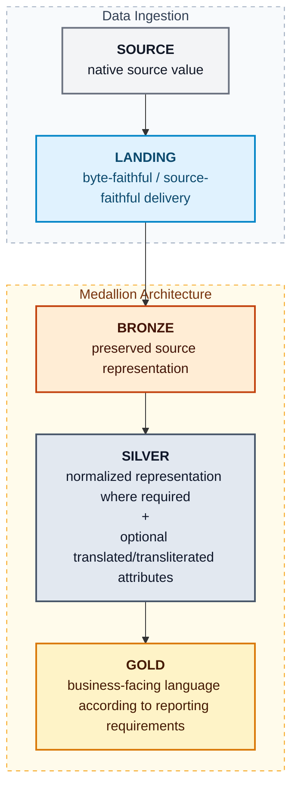
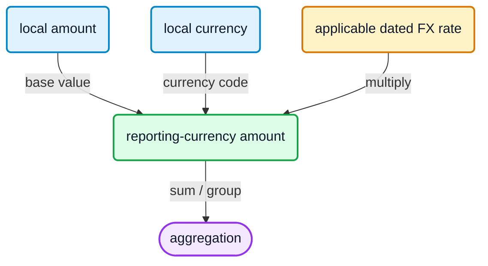

# Mercatura Data Platform - Project State Document

---

## Purpose

I am approaching project Meridan as the fictional Mercatura Group's reference implementation of a production-oridented modern data platform for multinational retail organisations.

It is intentionally significantly broader than previous projects, with the objective of expanding and testing software / data engineering practices currently understood my myself to the maximum. Therefore, it is not a collection of data engineering notebooks in isolation, I intend to create a full robust system from the ground up. 

The project will model the lifecycle of complex enterprise data from operational source data, through to intgetion, validation, transformation, analytical modelling, governance, deployment, observability, and failure recovery.

The flow of the project follows thsi generic structure overall:

- First discover the data (generated synthetically with a more advanced retail source data simulator)
- Ingest 
- Validate
- Transform
- Model
- Serve
- Govern
- Deploy
- Observe
- Recover
- Improve

With this more lengthy flow, I can demonstrate more advanced practical data engineering principles using a sufficiently realistic operational data estate.

---

## Current Status

As of now, the initial Azure and Databricks platform foundations are completed, and the deterministic multinational operational source estate has been implemented and validated.

The operational simulator is officially considered complete and ready for downstream ingestion.

I will not add any more operational behaviours to the simulator at this stage. However, I will add more if a later data platform requirement or demonstration opportunity warrants simulation extention. Or obviously, if the simulator needs correcting due to some issue downstream that requirs changes at source.

The immediate focus now is to move on to actual data engineering which is the focal point of this project and the learning it intends.

---

## Engineering Principles

Due to the sophistication of this project relative to my previous works, I am keeping documentation and the underlying engineering principles known and explicit.

Overall, Mercatura follows several overarching engineering principles that apply over the entirity of the project:

#### Preservation of source of truth 

Operational values are being retailed as they existed in the originating source system. Although, the platform itself may derive normalised, standarised, translated, converted, or more concise business facing representation of data downstream, this mutations of the source data are never replacing the original values.

For example, since the context of this project is a multinational retailed, I am ultimately dealing with different languages, currencies, and timezones. Consider, the following:

- A Japanese product description. With the preservation of source of truth principle being applied, the original japanese language description text at source is preserved, and later an english derivation can be used for presentation such as on a dashboards.

- A Chinese financial transaction will be preserved in the original Chinease Yuan amount. However, a GDP representation can be derived demonstream for english reporting figures using an explicity foreign exchange policy.

- A local timestamp will be preserved, and UTC and enterprise standard timestamps can be derived where its required.

#### Simulation of operational systems

The source systems have been designed and simulated occording to their operational responsibilities, rather than according to a dimensional model that will eventually consume the source data. Therefore, the simulated authentically represents source systems such as OMS, CRM, WMS, and Payments systems independently. 

#### The distinction between Bronze and Landing

Landing represents delivery from a source system into the data platform boundary. Whereas Bronze represents and ingested, governed, and queryable representation of the source data. That is the major distinction between the two.

#### Market and currency 

A key modelling choice in the simulator was to seperate the concept of markets and currency. A market way exist in the domain of a national currency, but is not exclisive to it. Several markets can share the same currency, and future systems may also allow more than one transactional currency within a market. Therefore, Ccurrency is represented explicitly rather than infered from market codes.

#### Local truth 

Local truth is to precede and enterprise standardization of data. Since Mercature operates internationally. Naturally, the platform is expected to encounter many different:

- Languages
- Currencies
- Timezones
- Calendars
- Taxation regimes
- Units of measure
- Names
- Address structures
- Telephone formats
- Regulatory environments

The enterprise normalization of all this data will happen downstream without destroying the original representation.

##### Determinism 

The retail source data simulator is deterministic. Therefore given the same configuration, seeds, generator version, scenario set, and defect set, the operational estate will be reproducible.

The determinism here is so I can accomplish: reproducible testing, reliable reconciliation, constrolled technical demonstrations, substantial regression testing, and repeatable ingestion experiments.

#### Financial vales and decimal arithmetic

Binary floating point arithmetic is not appropriate for financial values due to floating point error induction. The source system monetary values therefore use decimal arithemtic to resolve this. The same decimal arithmetic standard will be used continuosly through all the financial transformation logic. Furthermore, all currency conversions, allocations, and rounding policies will be made explicit.


#### Explicit temporal semantics

Temporal intervals have been explicitly defined with a clopen set convention `[from, to)`, the start of the interval is invlusive, and the tail of the interval is exclusive.

An example of this in practice is in the WMS implementation which uses `stocker_from <= date < stocked_to` where `stocked_to` exists.

Furthermore, I have ensured a strict distinction between different temporal fields. For instance, event time, processing time, extraction time, and business-effective time are treated independently rather than as interchangeable concepts, hence the different semantics surrounding these data fields.

#### Testing as a necessity 

Significant automated testing will be used throughout. These tests are good for verifying defined invariants. However, automated testing does not inherently prove that the generated data is completely economically or operationally realistic.

Therefore in this project I have employed a multitude of different verification procedures to evaluate the source estate including: the aforementioned automated testing suite, reconciliations, semantic inspections, distribution checks, and business reasoning.

---

## Beginning Phase - Platform Foundations

Before this development increment, I had already established the foundational Azure infrastructure and the Databricks control plane that is required for the later phases of the project.

The current development platform includes the following:

- Azure Resource Group: `rg-mercatura-dev-uks`
- Azure Databricks Workspace: `dbw-mercatura-dev-uks`
- Region: `UK South`
- ADLS Gen2 Storage Account: `stmercaturadev9756f9`
- Storage Containers: managed and landing
- Databricks Access Connector: `ac-mercatura-dev-uks`

Unity Catalog infrastructure includes:

- Storage Credential: `mercatura_dev_storage`
- External Locations: `mercatura_dev_managed`, `mercatura_dev_landing`
- Catalog: `mercatura_dev`
- Landing Schema: `mercatura_dev.landing`
- Source Volume: `/Volumes/mercatura_dev/landing/source_files`

The IAC (terraform), remote Terraform state, GitHib OIDC deployment, Databricks Asset Bundles, workspace groups, and platform grants have been established.

---

## Source Data Generation - Operational Source Estate

#### Simulation Temporal Window

The canonical simulated operational activity period runs from `2024-01-01` through to `2026-12-31`. Some of the entitiy lifetimes begin before the simulation activity window, this was accounted for using opening inventory to avoid abnormal stockouts and discontinuities in data. Some of the operational consequences may also accur after the primary activity window where the generated business events legitimately causes a later outcome.

Therefore, with this all in mind, it is important to interpret the activity window as seperate from the complete lifetime of every single entity as some can exist outside the temporal bounds.

#### Markets

The source estate model currently simulates data for the following markets:

| Market | Currency | Locale | Primary Time Zone |
| :--- | :---: | :---: | :--- |
| **GB** | `GBP` | `en_GB` | `Europe/London` |
| **DE** | `EUR` | `de_DE` | `Europe/Berlin` |
| **US** | `USD` | `en_US` | `America/New_York` |
| **CN** | `CNY` | `zh_CN` | `Asia/Shanghai` |
| **NO** | `NOK` | `no_NO` | `Europe/Oslo` |
| **RU** | `RUB` | `ru_RU` | `Europe/Moscow` |
| **JP** | `JPY` | `ja_JP` | `Asia/Tokyo` |
| **KR** | `KRW` | `ko_KR` | `Asia/Seoul` |
| **FR** | `EUR` | `fr_FR` | `Europe/Paris` |
| **NL** | `EUR` | `nl_NL` | `Europe/Amsterdam` |
| **PL** | `PLN` | `pl_PL` | `Europe/Warsaw` |

I am considering the canonical reporting currency to be GBP. This does not mean that all operational monetary values are stored in GBP, many other currencies are being preserved, the local transaction currencies are remaining authoritative within the operational systems. Currency translation for analytical reporting will be standardised to GBP (potentially with the option of reporting in different currencies) using a foreign currency exchange rate layer.

#### Source Systems

The source system estate contains a rich array of operational domains encompassing:

- STORE
- PIM
- ASSORTMENT
- PRICING
- SUPPLIER
- PROCUREMENT
- WMS
- CRM
- LOYALTY
- OMS
- PAYMENTS
- FULFILMENT
- RETURNS
- AVAILABILITY

The source system simulation is sophisticated enough to model demand, which provides coerent latent demand signals to the multiple operational data generators. The demand model is a simulation state rather than an operational source system itself, it acts as a modulator, and is therefore not exported as actual source data to be landed and ingested.

#### Canonical Source Estate Build

The source data estate is contructed via a singular canonical dependency-aware orchestration flow



The canonical source estate build command is:

```bash
uv run python \
  -m mercatura.source.estate.build
```

Also, a more inspective build without export can be executed with:

```bash
uv run python \
  -m mercatura.source.estate.build \
  --no-export
```

#### Canonical Simulation Run

The final validated canonical simulation has been run, passing validation. The run produced the following:

| Dataset | Rows |
| :--- | ---: |
| stores | 66 |
| products | 500 |
| assortments | 4,404 |
| prices | 8,635 |
| suppliers | 72 |
| supplier_capabilities | 238 |
| sourcing_agreements | 7,535 |
| purchase_orders | 39,072 |
| purchase_order_lines | 62,154 |
| purchase_order_line_fulfilments | 62,154 |
| supplier_shipments | 65,805 |
| goods_receipts | 65,805 |
| warehouses | 31 |
| inventory_locations | 155 |
| warehouse_assortments | 7,560 |
| inbound_receipt_routes | 62,154 |
| customers | 50,100 |
| loyalty_memberships | 20,936 |
| orders | 221,000 |
| order_items | 406,468 |
| payment_attempts | 240,837 |
| fulfilment_requests | 193,218 |
| fulfilment_allocations | 191,850 |
| inventory_reservations | 191,850 |
| outbound_shipments | 191,850 |
| customer_returns | 15,293 |
| return_dispositions | 15,293 |
| refunds | 15,293 |
| inventory_movements | 823,107 |
| availability_snapshots | 4,404 |

##### Internal simulator state

| Dataset | Rows |
| :--- | ---: |
| demand_profiles | 4,404 |


#### Core Estate Reconciliations

The final estate successfully passed the cross-system reconciliation. This means that the data satisfies the following core relationships such as:

- assortments = demand profiles = avaliability snapshots = 4404
- purchase-order lines = line fulfilments = inbound receipt routes = 62154
- supplier shipments = good receipts = 65804
- fulfilment allocations = inventory reservations = outbound shipments = 191850
- customer returns = return dispositions = refunds = 15293

Payments, fulfilment, refunds, and physical inventory relations are also validated by reconciliations rules spanning the entire estate.

#### Inventory Accounting Model

The canonical inventory accounting logic has the following rule:

`opening stock + goods receipts - outbound dispach + customer retunrs +/- disposition / adjustment effects = physical on-hand inventory`

Reservations are not physical inventory movements. Instead a reservation represents a claim against sellable inventory. The physical movement begins when fulfilment progresses through pick and dispatch.

The WMS movement model currently includes the following fields describing movement:

- OPENING_BALANCE
- RECEIPT
- PUTAWAY_OUT
- PUTAWAY_IN
- PICK_OUT
- PICK_IN
- DISPATCH
- RETURN_RECEIPT
- RETURN_TRANSFER_OUT
- RESTOCK_IN
- QUARANTINE_IN
- WRITE_OFF

Warehouse location semantics also distinguish:

- RECEIVING
- BULK_STORAGE
- PICK_FACE
- RETURNS
- QUARANTINE

The actual sellability of stock is determined by the inventory location semantics (warehouses in closer proximity to sellers are generally priority) rather than just the fact that physical stock exists.

#### Availability

The availability of stock is derived from an operational state. It is not a physical inventory event in itself, it is more of an effect than an entity. The final availability model derives at teh market-assortment grain: `sellable_on_hand, reserved_quantityl, available_to_promise, average_daily_units, days_of_cover, availability_status`.

Supported status of inventory include:

- IN_STOCK
- LOW_STOCK
- OUT_OF_STOCK
- UNAVAILABLE

An assortment can be physically present, yet it may be operationally unavailable if no active warehouse assortment currently can satisfy it.

#### Source Export

The canonical simulator exports source system datasets as newline delimited JSON (JSONL) under `artifacts/`:

```bash
artifacts/
└── source-estate/
    └── <simulation_id>/ # Simulations get their unique ids
        ├── manifest.json
        └── data/
            ├── stores.jsonl
            ├── products.jsonl
            ├── customers.jsonl
            ├── orders.jsonl
            ├── inventory_movements.jsonl
            ├── ...
            └── availability_snapshots.jsonl
```

JSONL does not necessarily need to be the dominant data format, nor am I implying that every single operational application would realistically deliver data as JSONL. 

Later, the extraction work could deliberately model hetrogeneous operational data delivery patterns without changing the underlying operational semantics. For example, I could extract operational data with: REST APIs, event streams, object-storage drops, database CDC. This will be reviewed when this development increment comes into focus and extraction becomes imperative.

#### Unicode and Multilingual Data

All the generated source system data JSONL files are encoded as UTF-8. The JSON serialization intentionally has `ensure_ascii = False` which preserves the native unicode characters directly rather than representing foreign language throigh ASCII escape sequences.

Therefore, the literal foreign languages are being preserved into the data platform and will not be translated at ingestion. Instead of later translation policy may be applied downstream such as:



The translation / transliteration transformation is being treated as data enrichment instead of replacement of source truth.

Maintaining the source of truth is important, for instance personal names generally should not be translated flippantly since this could cause issues with customer-data matching.

Also, unicode normalization may be required for comparisons, matching, and deduplication processes. Where normalization is required, NFC can be considered for normalized analytical fields, while also preserving the source representation faithfully.

#### Currency and Foreign Exchange

The operational monetary transactions preserve both the currency and the amount. Again, with all the source data, an original source records currency and amount is authoratative. Even with different foreign exchange rates and changes in these rates, the original values are not being overwritten in response to exchange rate changes. 

A change in currency values changes the equivalent enterprise reporting value without mutating the original local transaction value.

For instance, 700 CNY at transaction time remains 700 CNY even if the Chinese Yuan value subsequently strengthens or weakens.

GBP reporting values will be derived downstream using a foreign exchange policy. The appropriate rate would depend on the analytical or accounting use case. For instance, management reporting and financial consolidation can legitimately produce different GBP figures if the use different approved foreign exchange policies. However, all cross-currency amounts will not be aggregated before convertion to an explicitly declared common reporting currency.



The foreign exchange will enter the data platform as external / reference data during downstream ingestion.

#### Additional International Data Considerations

International data estates creates more complex requirements alongside the aforementioned core multilingual text and foreign exchange considerations. These following factors may be addressed in later phases depending on project scope.

##### Timezones

For intenational data systems, operational timestamps originate across different timezones. The DST rule are different for different regions. Therefore, timestamps must retain sufficient information to effectively distinguish between: local event time, UTC event time, source time zone, processing time, and ingestion time.

Timezone normalization may be considered, but this must not degrade the original business-time context.

##### Locale Formatting

Different systems represent data differently with respect to region. Things such as: dates, decimal separators, thousands separators, currency symbols, text casing, telephone numbers, and postal codes may be radically different. 

To handle this, these could be parsed according to explicit contrats rather than inferred heuristically where possible.

##### Currency Precision

Another international data system issues is that not every currency uses the same accounting precision. Therefore assumptions regarding monetary precision must be well justified and account for this differences.

It would therefore, be superficial to assume that every currency is a decimal values with two decimal places.

This introduces the potentiality that monetary calculations must have awareness of currency precision and the relevant rounding rules associated with different currencies.

##### Tax

Since the source data is from operational systems spanning across many jurisdictions with different tax regimes, this introduces another layer of complexity.

Different tax regimes may mean different: VAT, sales tax, tax-inclusive pricing, tax-exclusive pricing, and regional tax rates. 

The future financial models may therefore need to have to ability to distinguish between gross sales, net sales, tax, discounts, and refunds. Rather than reating over order total as sufficient for every financial accounting question dowmstream analytics aim to satisfy.

##### Units of Measure

Products, logistics, and inventory systems may use different regional units of measure. For instance, one region may use grams, another may use kilograms. Therefore another conversion layer may be another implementation to enrich realism.

Like with the currency conversion philosophy, the unit measurement conversion follows the same convention: preserve the source value, preserve the source unit, then derive a standarised converted value where required.

##### Names and Addresses

Naming and address conventions differ intentionally, so assumptions may not be applicable cross-region. For instance, it would be not ideal to assume that every person has a first, middle, and last name in the same cultural sense.

Therefore, the canonical modelling should retain enough source information to avoid potentially destructive normalization.

##### Regional Calendars

Business activities are notably affected by public holidays, weekends, regional trading days, and retail events.

These could be represented via an explicit calendar / reference demension rather than scattered business logic.


##### Privacy and Data Residency

The CRM and loyalty data contains PII. Therefore the platform desins must consider: access controls, purpose limitation, data retention policy, PII masking, deletion policy, regional data regulations, data residency, and auditability. 

##### Capabilities Being Deferred

Currently, I am not attempting to simulated each and every single possible international enterprise process as that would be extreamly complex and time consuming.

Some of the intentionally deferred capabilities include:

- full tax accounting
- foriegn exchange feeds
- financial general ledger
- warehouse-warehouse transfers
- supplier invoice processing
- complex discounting engines
- promotion optimisation
- fraud systems
- customer service systems
- chargebacks
- full event streaming 

I may implement deferred capabilities but only if they actually add value to the downstream engineering objectives.

#### Testing State

At this point, the project currently passes the complete automated test suite including:

- approximately 930 automated tests
- Ruff formatting and checks
- Pyright 
- Complete estate reconciliation


